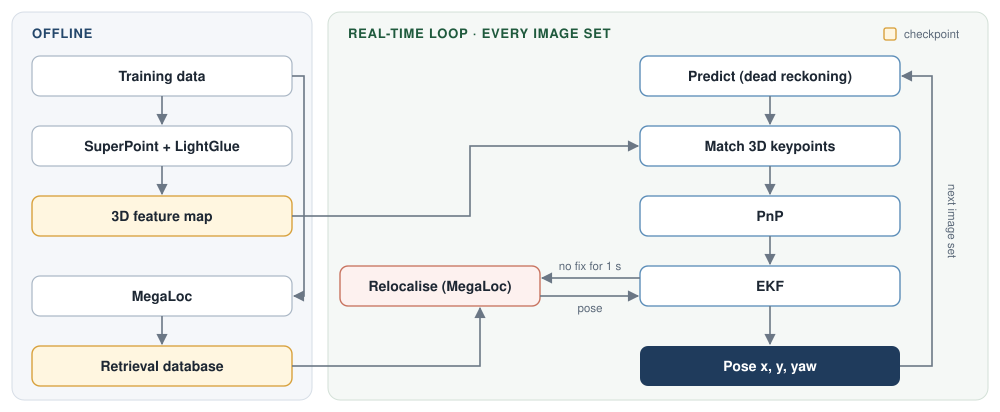

# odosseus: camera-only localisation on Yas Marina

National AI Hackathon 2026, Constructor Labs challenge "Camera-based localization on a race track".

A causal 10 Hz estimate of the race car's pose (x, y, yaw of `constructor0/base_link` in `map`) from its 7 cameras,
the allowed car-state fields and the first pose of the run. A car-state EKF predicts the pose. Every image set is
matched against a 3D feature map built offline from the training run, and one multi-camera PnP turns the matches into
a fix. MegaLoc retrieval relocalises the filter when it is lost.

* **Night validation** (lap held out of the map, official scoring script): **0.089 m** position RMSE on an unseen
  flying lap; 0.299 m on the hardest lap, which is driven off the mapped lines.
* **Runtime:** 37 ms per 7-camera image set on one NVIDIA H100 NVL (the camera period is 100 ms).
* **Coverage:** one pose per image set, 100 %.
* **Run:** `./run.sh <test.mcap> <out_dir> --first_pose` writes `<out_dir>/submission.csv`.

## Repository

```
run.sh            single run script: test bag + first pose -> submission.csv
requirements.txt  inference dependencies
odo/              the localiser: online.py (filter, matching, PnP, relocalisation; DEFAULT = final parameters),
                  map_build.py, vpr.py (MegaLoc), first_pose.py, data.py, metrics.py (= tools/evaluate.py), reports
scripts/          bag extraction, checkpoint tools, and the experiments behind the numbers below
assets/           the approach figure
Presentation/     the slides (HTML and LaTeX Beamer)
visualization/    the dashboard used for the presentation videos; it runs on the pipeline in localization/ of
                  branch praffulr_dev, not on this branch
```

## Approach



**Offline, once, from the training run.** For every frame of every camera, SuperPoint keypoints are matched with
LightGlue to the previous and next frame and triangulated with the training GT poses. Map frames whose GT accuracy
flag exceeds 1 m are skipped. The result is 20 M 3D points with descriptors, plus one MegaLoc global descriptor per
training image set. These are the checkpoints. The test run is never added to the map.

**Online, per image set** (causal: only images and car-state samples up to its stamp):

1. **Predict.** An EKF on (x, y, yaw) is driven by car-state dead reckoning (vx, vy, yaw rate). Its process noise
   grows with the distance driven.
2. **Match.** The map frames of the 3 nearest passes are projected with the predicted pose. Each map point is matched
   to a SuperPoint keypoint of the query inside a small window (descriptor similarity), for all 7 cameras, on the GPU.
3. **Solve.** One robust PnP over all cameras estimates x, y, yaw plus small roll, pitch and height corrections
   (with priors), followed by a second, tighter matching pass. A fix needs at least 30 inliers. Its covariance
   (×4, plus a floor of 0.10 m and 0.23°) is the measurement noise.
4. **Update.** A Mahalanobis gate (χ² 16) accepts or rejects the fix. Weak fixes (fewer than 60 inliers) update the
   position only. If 8 rejected fixes agree with each other, they replace the state (challenger), so the filter can
   escape a wrong state.
5. **Relocalise.** After 1 s without an accepted fix, MegaLoc retrieval proposes 4 spatially distinct candidates,
   each verified by wide-radius matching and PnP. A jump is accepted only if it is plausible for the time without a
   fix (0.5 m + 0.3 m/s, 0.3° + 0.1°/s) or has at least 300 inliers.

Every image set gets a pose, stamped with its image header stamp. The camera clock was calibrated against the GT
clock (−9.1 ms). All parameters are in `odo/online.py: DEFAULT`.

## Design decisions and how they were validated

* **Car state, not visual odometry, for the prediction.** Dead reckoning from the car state alone ends at 20.5 m
  RMSE over two laps (223 s). The best camera-only visual odometry we built reached 43 m, and over 1–10 s the car
  state is about 4× more accurate. So the cameras are used only for absolute fixes against the map
  (`scripts/exp01_deadreckoning.py`; the visual-odometry experiments are in commit `d93e142` of `main`).
* **Only plausible relocalisation jumps.** In the first cross-validation, one false MegaLoc relocalisation cost the
  hardest lap L2 3.7 m RMSE: an 18 m jump while the car was off the mapped lines. Since then a jump must be plausible
  for the time without a fix or be backed by at least 300 inliers, and no relocalisation is tried where no map is
  near. L2 went from 3.7 m to 0.30 m.
* **What is tuned.** The parameters that matter are the number of keypoints, the SuperPoint descriptor similarity
  thresholds, the EKF process noise and the PnP covariance multiplier. During development, sweeps over these, the
  number of map passes, the noise floors and the priors all landed at 0.103–0.108 m on the development laps, next to
  the GT's own accuracy (~0.1 m). The optimum is flat (`scripts/sweep_online.py`, `scripts/tune_l5.py`).
* **Why sweeps and lap cross-validation.** They show that the ~40 parameters are not tuned to one train/validation
  split, check that no lap has a failure mode, and find cheaper settings. Each lap was held out of the map once.
  Parameters were chosen on one tuning lap (L5) only, which is in none of those maps.
* **Kidnap test.** A wrong pose is injected into the running filter, as after a bad fix or a long blind stretch.
  Errors of 3–80 m and up to 20° are recovered (below 0.3 m for 1 s) after 1.0–3.4 s
  (`scripts/exp24_kidnap_final.sh`).
* **Weak matching must not take over the filter.** Three rules act only when matching is weak or a relocalisation
  jump is large, so well-matched laps are unchanged:
  * weak fixes (fewer than 60 inliers) update the position only; the heading stays with the car-state yaw rate;
  * a relocalisation must be plausible in yaw (0.3° + 0.1°/s, about 3–4× the measured dead-reckoning yaw drift);
  * it must also be plausible in position (0.5 m + 0.3 m/s, the measured p95 drift of dead reckoning,
    `scripts/dr_calibration.py`).

## Results with the submitted configuration

### Night validation

Each lap is localised as its own run, starting from its first GT pose, against a map of other laps only. It is scored
with the dataset's `tools/evaluate.py` against the GT cut to the lap.

| lap | map (night laps) | role | position RMSE | ≤ 1 m |
|---|---|---|---|---|
| L7, flying lap, up to 40 m/s | L0 L1 L3 L4 L6 L8 | validation, never used for tuning | **0.089 m** | 100 % |
| L2, warm-up lap on its own line, up to 14 m from every other lap | L0 L1 L3 L4 L6 L8 | hardest lap | 0.299 m (lateral 0.269 m) | 97.5 % |
| L5, partial lap | L0 L2 L3 L4 L7 L8 | tuning lap | 0.089 m | 100 % |

For the test run the map holds all 9 laps.

### Runtime and hardware

Mean processing time per 7-camera image set, from image decoding to the pose: 37 ms (night lap L2), on one NVIDIA
H100 NVL with an AMD EPYC 9454 host. Start-up (map loading) takes about 10 s, and the GPU memory
needed is about 12 GB. `./run.sh` writes the measurement of the test run to `runtime.txt`.

### Failure cases and limits

* **Off the mapped lines.** Where L2 drives up to 14 m from every other lap, the map constrains the position well
  along the track but poorly across it. In the cross-validation the error peaked at 1.7 m, almost entirely lateral,
  when the inliers collapsed in all camera groups.
* **No map.** The pit exit is driven only in L0. With L0 held out, the filter ran on dead reckoning there for about
  30 s (up to 2.4 m). The test-run map contains all laps.
* **Matching fails entirely** (e.g. a strong appearance change): dead reckoning bridges the gap (about 10 m of drift
  per lap) until a fix or relocalisation succeeds.

## Rules compliance

* **Inputs at inference:** camera images, their calibration (`camera_info`, `/tf_static`), the car-state speed and
  yaw rate (v, vx, vy, wz) and the first pose. Track borders, LiDAR, radar and GNSS are not used.
* **Ground truth** is used only offline, from the training run (map triangulation, the map-frame accuracy filter,
  the relocalisation database poses), and for the test run's first pose. Right after extraction, `run.sh` cuts the
  test run's `/tf` to its first pose and keeps only the allowed car-state fields, so no later ground truth can reach
  the localiser.
* **Causal:** the pose of an image set uses only images and car-state samples up to its stamp.
* **Pretrained models** are declared below. No external datasets are used.

## Install

Python 3.11 and one CUDA GPU with about 12 GB of memory (tested on an H100 NVL, CUDA 12.4).

```bash
conda create -n odosseus python=3.11 && conda activate odosseus
pip install -r requirements.txt
```

The networks download on first use: SuperPoint from GitHub, and MegaLoc's code from GitHub and its weights from
Hugging Face. The first run needs internet.

## Checkpoints

| path | size | content |
|---|---|---|
| `outputs/20_map/<cam>.npz` (7 cameras) | 10.6 GB | 3D map: SuperPoint keypoints of every training frame, matched with LightGlue and triangulated with the training GT (points, descriptors, frame poses) |
| `outputs/20_map/train_ref.npz` | small | training GT poses and the GT accuracy flag, read at inference (map filter, relocalisation database, stand-in start) |
| `outputs/10_vpr_desc/megaloc_<cam>_{train,val,L8}.npz` | 1.4 GB | MegaLoc descriptors of the training images (relocalisation database) |

Load them with `bash scripts/download_checkpoints.sh <URL or folder>`. The script copies or downloads them into
`outputs/` and checks them against `checkpoints.sha256`. `./run.sh` stops with this instruction when one is
missing; the training bag is not needed at inference. The checkpoints contain data derived from the challenge
dataset ("for use in the National AI Hackathon 2026 only, no redistribution"), so they are shared privately with the
organizers. To rebuild them from the training bag, see [Reproduce the results](#reproduce-the-results).

## Run on the test run

```bash
./run.sh <test.mcap> [out_dir] --first_pose [FILE]   # the given first pose; FILE omitted: the first /tf pose in the bag
./run.sh <test.mcap> [out_dir] --no_first_pose       # fallback when no first pose is available
```

* `--first_pose [FILE]`: FILE is a csv whose first row has `x, y, yaw` (yaw in rad, or a quaternion
  `qx, qy, qz, qw`) and optionally `timestamp_ns` (without it, the pose is taken at the first image). Without FILE,
  the first `/tf` pose of the test bag is used, and only that row is kept.
* `--no_first_pose`: a stand-in start pose. The whole run's car-state motion is matched by curvature to a night lap
  of the map run. It is a few metres off, so the filter starts with σ 3 m / 1° (`odo/first_pose.py`).
* Without a start-pose flag, `run.sh` prints the options and exits. It checks the GPU, the checkpoints and the test
  bag before the long steps.

Output in `<out_dir>` (default `outputs/submission`):
* `submission.csv`: `timestamp_ns,x,y,yaw`, one row per image set, with the header stamp of the image set;
* `runtime.txt`: poses, 1 s coverage, mean processing time per frame, GPU;
* `online_info.csv`: per-frame diagnostics;
* `run.log`.

## Reproduce the results

The training bag is extracted to `data/extracted`. All commands run from the repository root.

```bash
python scripts/extract_mcap.py data/c0_2026-10-13_22-53-42_camloc/c0_2026-10-13_22-53-42_camloc_0.mcap data/extracted

# checkpoints (instead of downloading them; ~70 min on one GPU)
for c in fl fr cl cr r rl rr; do python -m odo.map_build --cams $c --out outputs/20_map; done
python -m odo.vpr --model megaloc --cams fl fr cl cr r rl rr --splits train val L8 --out outputs/10_vpr_desc
python scripts/build_train_ref.py

# night validation: L5, L7 (validation) and L2 against the map L0 L1 L3 L4 L6 L8; L5 against L0 L2 L3 L4 L7 L8
python scripts/exp21_cv.py F5 --video
python scripts/exp21_cv.py F1 --tune_only
python scripts/cv_summary.py                 # per-lap metrics; writes the GT cut to each lap
python data/c0_2026-10-13_22-53-42_camloc/tools/evaluate.py \
    outputs/21_online/cv/F5/L7/gt_L7.csv outputs/21_online/cv/F5/L7/pred.csv

# test mode on laps with known GT: a 'test run' folder from t >= 897 s (L6-L8), GT only as first_pose.csv,
# map restricted to the earlier laps
python scripts/make_fake_test.py data/fake_test
python -m odo.online --split test --query data/fake_test --out outputs/fake_test \
    --first_pose data/fake_test/first_pose.csv --map_until 897

# design decisions
python scripts/exp01_deadreckoning.py        # car state alone
bash scripts/exp24_kidnap_final.sh           # kidnap recovery
python scripts/dr_calibration.py             # dead-reckoning drift against the GT
python scripts/tune_l5.py <name> '<cfg json>'      # one setting on the tuning lap L5, under each fold's map
python scripts/sweep_online.py <name> '<cfg json>' # one setting on the development laps
```

Results are written under `outputs/` (one folder per run, with `pred.csv`, `online_info.csv` and the metrics).
`--video` adds the visualisation of a validation lap: `report_<lap>.pdf` (track map coloured by error, errors over
time), `traj_<lap>.html` (interactive) and `debug_<lap>.mp4` (camera view next to a local map with live errors).

## Pretrained models (declared)

| model | use | source | licence |
|---|---|---|---|
| SuperPoint | keypoints and descriptors: map build and every test image set | weights via [cvg/LightGlue](https://github.com/cvg/LightGlue) | Magic Leap, non-commercial |
| LightGlue | matching between training frames (map build only) | [cvg/LightGlue](https://github.com/cvg/LightGlue) | Apache-2.0 |
| MegaLoc (DINOv2 backbone) | descriptors of the training images (checkpoint) and of the test image set when relocalising | [gmberton/MegaLoc](https://github.com/gmberton/MegaLoc) via `torch.hub` | MIT |
| CycleGAN-Turbo `night_to_day` | night-to-day translated images for robustness tests during development; not used at inference | [GaParmar/img2img-turbo](https://github.com/GaParmar/img2img-turbo) | see the repository |

Code licence: GPL-3.0 ([`LICENSE`](LICENSE)).
