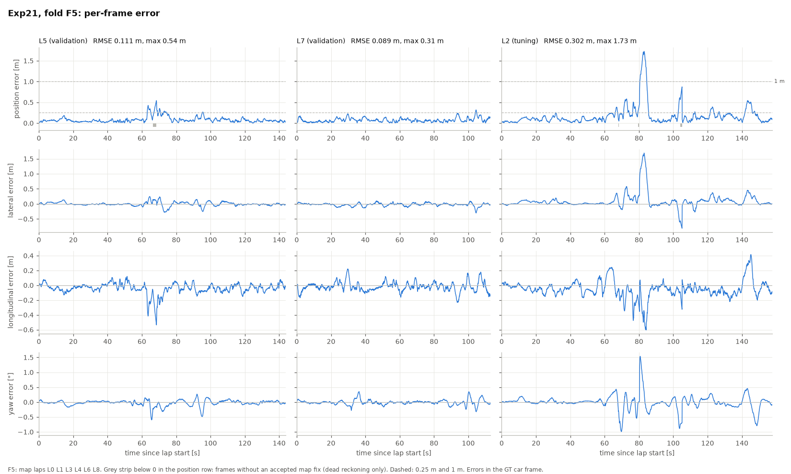
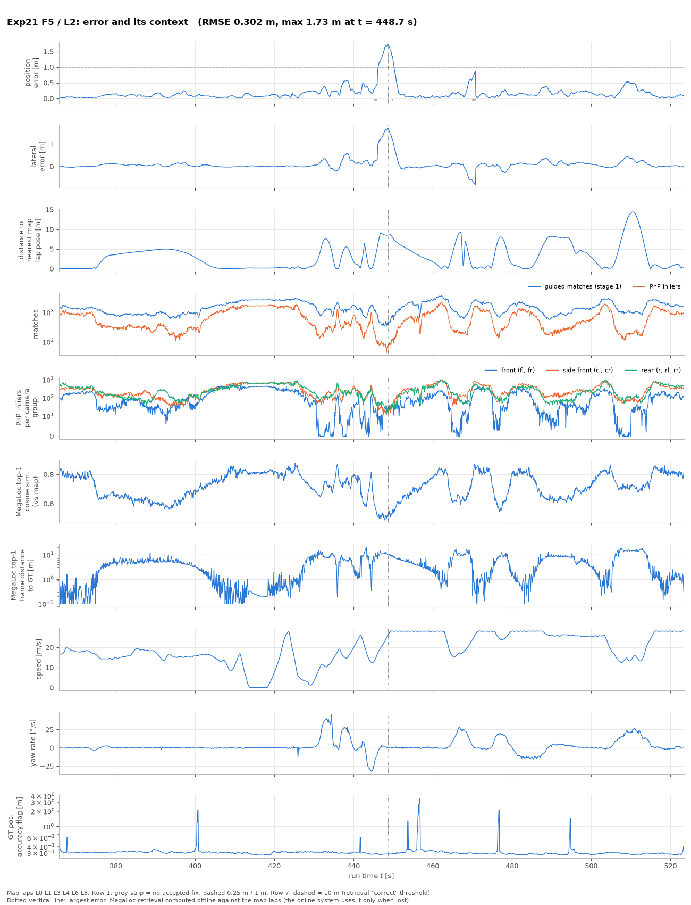
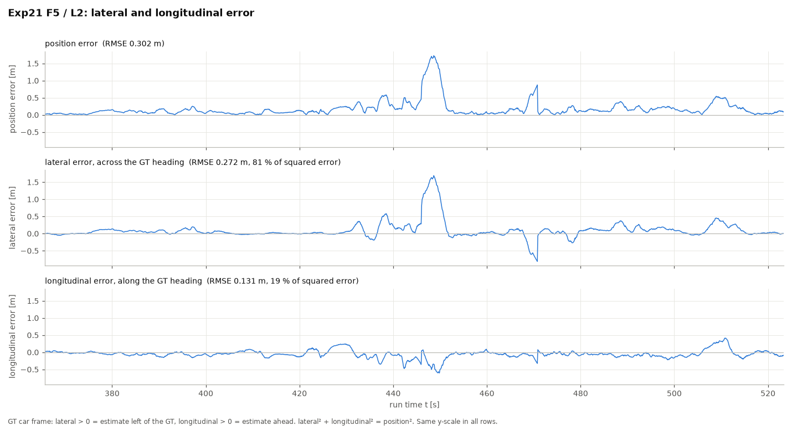

# Exp21 cross-validation performance per fold and validation lap

Method: Exp21 online localiser (car-state EKF + cached map of the fold's map laps + guided matching + 6-DoF PnP,
7 cameras, causal, ~41 ms per image set). Split and laps: [`laps.md`](laps.md). Each validation lap is run as its own
segment, starting from its first GT pose; parameters are frozen (chosen on the tuning lap L5 only). Errors are in the
GT car frame; coverage is 100 % on every lap. Source: `outputs/21_online/cv/cv_summary.csv` (`scripts/cv_summary.py`),
this file: `scripts/cv_table.py`. Per-lap reports, maps and videos: `outputs/21_online/cv/<fold>/<lap>/`.

## Per fold: validation laps and the tuning lap

Each fold's map (`docs/laps.md`) is also run on its tuning lap (L5 for F1–F4, L2 for F5 and F6).

| fold | lap | role | pos RMSE [m] | p95 [m] | yaw RMSE [°] | ≤ 1 m | max [m] |
|---|---|---|---|---|---|---|---|
| F1 | L1 | validation | 0.080 | 0.151 | 0.055 | 100.0 % | 0.23 |
| F1 | L6 | validation | 0.083 | 0.144 | 0.074 | 100.0 % | 0.30 |
| F1 | L5 | tuning | 0.089 | 0.153 | 0.085 | 100.0 % | 0.37 |
| F2 | L2 | validation | 0.302 | 0.526 | 0.254 | 97.5 % | 1.73 |
| F2 | L7 | validation | 0.089 | 0.170 | 0.088 | 100.0 % | 0.31 |
| F2 | L5 | tuning | 0.111 | 0.252 | 0.104 | 100.0 % | 0.54 |
| F3 | L3 | validation | 0.068 | 0.124 | 0.059 | 100.0 % | 0.18 |
| F3 | L4 | validation | 0.117 | 0.210 | 0.103 | 100.0 % | 0.48 |
| F3 | L5 | tuning | 0.088 | 0.148 | 0.088 | 100.0 % | 0.38 |
| F4 | L0 | validation | 0.686 | 1.614 | 0.470 | 87.2 % | 2.38 |
| F4 | L4 | validation | 0.117 | 0.210 | 0.101 | 100.0 % | 0.47 |
| F4 | L7 | validation | 0.088 | 0.172 | 0.083 | 100.0 % | 0.36 |
| F4 | L5 | tuning | 0.085 | 0.134 | 0.087 | 100.0 % | 0.38 |
| F5 | L5 | validation | 0.111 | 0.252 | 0.104 | 100.0 % | 0.54 |
| F5 | L7 | validation | 0.089 | 0.170 | 0.088 | 100.0 % | 0.31 |
| F5 | L2 | tuning | 0.302 | 0.526 | 0.254 | 97.5 % | 1.73 |
| F6 | L1 | validation | 0.082 | 0.147 | 0.054 | 100.0 % | 0.23 |
| F6 | L6 | validation | 0.080 | 0.145 | 0.073 | 100.0 % | 0.29 |
| F6 | L2 | tuning | 0.154 | 0.324 | 0.190 | 100.0 % | 0.53 |

## Per-frame error, F5

Columns: L5, L7 (validation), L2 (tuning); rows: position, lateral, longitudinal, yaw error vs time since the lap start.
Grey strip under the position curve: frames without an accepted map fix. Made by `scripts/plot_per_frame.py F5`
(also `outputs/21_online/cv/F5/per_frame_error.pdf`). L2 peaks at 1.7 m about 80 s into the lap (t ≈ 445 s), where it
drives a line far from the map laps; L5 has a short 0.5 m excursion at ~67 s with a few frames without a fix.

## F5 / L2 in detail: why the error peaks

Made by `scripts/plot_lap_diagnostics.py F5 L2` (also `outputs/21_online/cv/F5/L2/diagnostics.pdf`). Rows: position and
lateral error; distance of the driven line (GT) to the nearest pose of any map lap; guided-matching quality (matches and
PnP inliers, in total and per camera group); MegaLoc retrieval of each frame against the map laps (top-1 similarity and
the top-1 frame's distance to the truth; computed offline, the online system uses it only when lost); speed; yaw rate;
the ground truth's own accuracy flag.

* **The peak (1.73 m at t = 448.7 s)** is where several things coincide: the car is 8.5 m from every map lap, PnP
  inliers fall to ~60 (all camera groups at 20–30), MegaLoc similarity drops to its lap minimum (0.51) and its top-1
  frame is 10 m away. It is the exit of a slow left–right sequence (yaw rate −30°/s at 445 s) onto a straight,
  accelerating to 28 m/s. The error is almost entirely lateral.
* **Distance to the map lines explains much of the error** (correlation 0.49 over the lap; median distance 2.1 m).
  It is not sufficient on its own: at t ≈ 510 s the car is 14 m off, but side and rear cameras keep 100+ inliers and
  the error stays at 0.5 m. Failure needs a large distance **and** a collapse of the matches in all camera groups.
* **The front cameras drop out first** (fl, fr inliers often 0 in corners); side and rear cameras carry the fixes.
* **Retrieval would not rescue it:** where the error peaks, MegaLoc's best map frame is itself ~10 m away (top-1
  within 10 m on 89 % of the lap). The map simply has no view from this line.
* **GT is not the cause here:** the accuracy-flag spikes (2–3 m at 400, 456, 476 s) do not line up with the error
  peaks.

Lateral error and its complement, the longitudinal (along-track) error, on the same scale (`scripts/plot_lat_lon.py F5 L2`).
The lateral component carries 81 % of the squared error (RMSE 0.272 vs 0.131 m). At the peak (t = 448.7 s) the
estimate is 1.69 m to the left of the truth and only 0.35 m behind; the longitudinal error never exceeds 0.60 m.
Off the mapped lines, the map points constrain the position along the track well but not across it.

## Notes

* **L2 (F2)** is a warm-up lap driven on a different line, up to 14 m from every other lap, so map support is sparse
  (max error 1.7 m). **L0 (F4)** is the out-lap: its pit exit is driven only in L0, so the F4 map has no data there and
  the filter runs on dead reckoning for ~30 s (drift up to 2.4 m). For the hidden test run the map contains all laps.
* L4 appears in F3 and F4; under the legacy split it was a development lap, so its numbers are slightly optimistic.
* **F5** uses the same map as F2 with the roles of L2 and L5 swapped (L2 = tuning lap). The parameters were not
  re-selected on L2; they are the ones chosen on L5, so F5's L5 score is not an unseen-lap result. Since map and
  parameters are the same, F5 reproduces F2 lap by lap (L5 0.111 m, L7 0.089 m, L2 0.302 m).
* **F6** is F1's map with L2 replaced by L5 (map L0 L3 L4 L5 L7 L8, L2 = tuning lap). L1 and L6 stay at
  0.08 m, and L2 improves from 0.302 m (F2/F5 map) to 0.154 m: L2's unusual line is better covered by a map that
  contains L5 and L7. As in F5, parameters were chosen on L5, which is in F6's map.
* Official `tools/evaluate.py` gives the same numbers with the GT cut to the lap: `outputs/21_online/cv/<fold>/<lap>/gt_<lap>.csv`.
