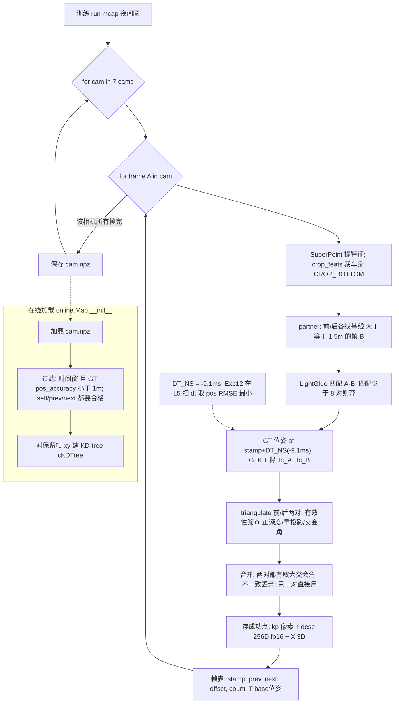
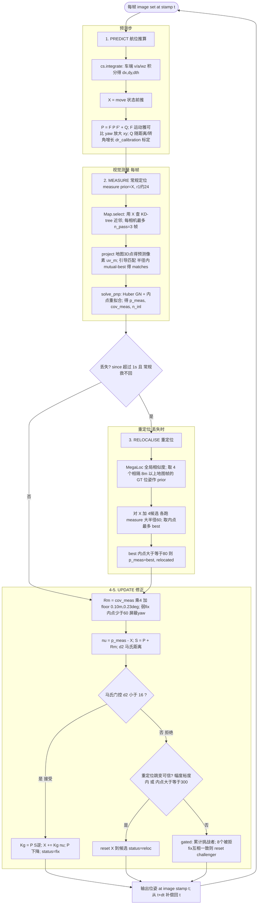

# 流程图：建图 / 在线预测与更新

两张端到端流程图，配套各环节的详细文档（见每节链接）。

> 说明：为兼容各 Markdown 预览器的 mermaid 解析，节点文字尽量用纯文本（避免 `<` `>` `&` 等特殊字符）。

---

## 1. 建图（offline，一次性）

对应代码 [`odo/map_build.py`](../odo/map_build.py) + 加载过滤 [`odo/online.py` `Map.__init__`](../odo/online.py#L45)。详见 [map_build.md](map_build.md)。

### 为什么存这张「帧表」

`<cam>.npz` 把**所有帧**的 3D 点/描述子**拼接成一个大数组**（`X`、`desc`、`kp`，[`map_build.py` L117](../odo/map_build.py#L117)），而不是按帧分开存。所以必须有一张**逐帧的索引 + 元数据表**（[`map_build.py` L109-L111](../odo/map_build.py#L109)），告诉在线端“第 i 帧对应大数组里哪一段、它拍在哪、能不能用”。每个字段都有明确消费者（[`online.py` Map.__init__ L62-L75](../odo/online.py#L62) / `Map.gather` L94-L101）：

| 字段 | 是什么 | 为什么要存（谁用） |
|---|---|---|
| `offset` + `count` | 该帧的点在拼接数组里的**起始下标**和**点数** | 大数组是所有帧点云首尾相接的；`offset/count` 是**切片指针**——取第 i 帧的 3D 点/描述子就是 `X[offset : offset+count]`。没有它无法从一维大数组里还原“哪些点属于哪一帧”（[`Map.__init__` L66-L68](../odo/online.py#L66)、[`Map.gather` L97-L101](../odo/online.py#L97)）。`count>0` 也用来过滤没三角化出点的空帧（[L63](../odo/online.py#L63)）。 |
| `T` (base 位姿) | 该帧拍摄时车的 GT 位姿（4×4） | 多用途：① `T[:,:2,3]` 取 (x,y) 建 **KD-tree** 并做近邻选帧；② `yaw=atan2(T)` 做朝向过滤；③ 定位时把地图 3D 点**投影**到图像、以及给 PnP 提供 z/roll/pitch 基准都要这帧的位姿（[L69-L75](../odo/online.py#L69)）。 |
| `stamp` | 该帧（A）的时间戳 | ① 加载时按**时间窗**过滤（哪段属于当前 fold 的地图）；② 查该时刻的 **GT pos_accuracy** 做 1m 精度过滤与 risk；③ `Map.select` 里按 `stamp` 分「趟(pass)」，每趟取最近帧（[L63-L66](../odo/online.py#L63)、[L87](../odo/online.py#L87)）。 |
| `stamp_prev` / `stamp_next` | 三角化该帧时用的**前/后配对帧**的时间戳（无则 0） | 这帧的 3D 点是 A 和 prev/next 两帧三角化出来的，所以**配对帧的 GT 精度也必须合格**——加载时要求 self + prev + next 三个 stamp 的 `pos_accuracy` 都 <1m，否则整帧丢弃（[L63-L66](../odo/online.py#L63)）。`0` 表示该方向没配对帧，豁免检查。 |

> 一句话：点云用「拼接大数组 + 逐帧 (offset,count) 切片」存，省内存、加载快；`T/stamp/prev/next` 则是把每帧「定位到空间(T)、定位到时间(stamp)、记住它的三角化依赖(prev/next)」，供在线端做 KD-tree 选帧、投影、时间窗/精度过滤。

---

## 2. 在线预测与更新（每帧，causal）

对应 [`odo/online.py`](../odo/online.py) 主循环。详见 [pnp.md](pnp.md)（PnP）、[online_ekf.md](online_ekf.md)（测量噪声 R）、[ekf_update.md](ekf_update.md)（门控/弱 fix/challenger）、[relocalise.md](relocalise.md)（重定位）。

---

## 相关文档

| 文档 | 内容 |
|---|---|
| [map_build.md](map_build.md) | 建图 + `DT_NS` 标定 + 加载过滤 (GT 精度 / KD-tree) |
| [retrieval.md](retrieval.md) | 全局检索粗定位 `init`（离线 `qsplit` 版）|
| [pnp.md](pnp.md) | PnP：投影链 / 残差 / 雅可比 / 协方差 / 引导匹配 vs 内点 |
| [online_ekf.md](online_ekf.md) | 测量噪声 `R` = PnP 协方差 ×4 + floor |
| [ekf_update.md](ekf_update.md) | 更新步：马氏门控 / 弱 fix / 挑战者 |
| [relocalise.md](relocalise.md) | 重定位：MegaLoc 候选 prior / 大半径 PnP / 跳变接受 |
